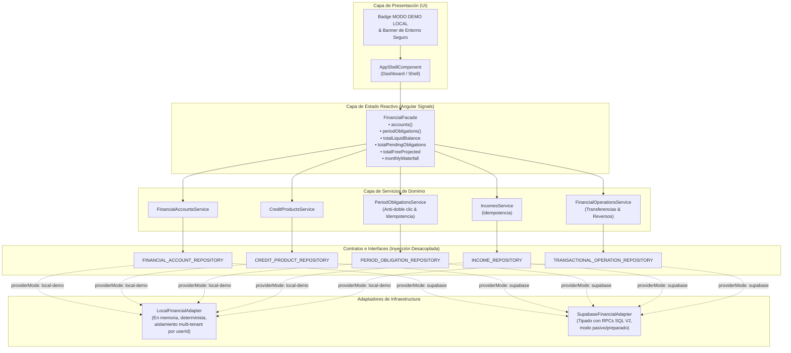

# Personal Finance — Sprint 2 / Fase 1: Arquitectura de Integración Financiera Angular

**Fecha:** 15 de Octubre de 2026  
**Rama de trabajo:** `feat/financial-core`  
**Entorno activo:** `local-demo` (Totalmente desacoplado, sin conexión remota a Supabase)  
**Estado:** COMPLETADO CON ÉXITO — LISTO PARA REVISIÓN  

---

## 1. Resumen Ejecutivo

En cumplimiento de las especificaciones del **Sprint 2 / Fase 1**, se ha construido la arquitectura integral de integración financiera para **Personal Finance** en Angular 22.

Esta capa actúa como el puente reactivo y desacoplado entre la interfaz de usuario (UI), el motor financiero V2 (`FinancialCalculatorV2`) y las fuentes de datos (adaptador local en memoria y adaptador remoto Supabase basado en RPCs atómicas).

### Principios Cumplidos:
1. **Desacoplamiento Estricto:** Los componentes de Angular nunca interactúan directamente con Supabase ni con lógica de bajo nivel. La comunicación sigue el flujo unidireccional:
   $$\text{Componentes UI} \longrightarrow \text{FinancialFacade} \longrightarrow \text{Domain Services} \longrightarrow \text{Repositories} \longrightarrow \text{Local/Supabase Adapter}$$
2. **Seguridad Absoluta de Datos Reales:** Por diseño y configuración explícita (`providerMode: 'local-demo'`), la aplicación no ejecuta consultas remotas, migraciones ni escrituras sobre el proyecto Supabase de producción.
3. **Idempotencia y Anti-Doble Clic:** Mecanismos deterministas impiden la duplicación accidental de operaciones financieras críticas (pagos, transferencias e ingresos).
4. **Reactividad basada en Angular Signals:** Exposición de métricas en tiempo real con `signal` y `computed`, distinguiendo rigurosamente entre saldos líquidos reales, pasivos consolidados y proyecciones del período (dinero libre y cascada de amortización).

---

## 2. Arquitectura Implementada y Flujo de Dependencias



---

## 3. Archivos Creados y Modificados

### A. Nuevos Archivos de Configuración, Contratos y Adaptadores
| Archivo | Responsabilidad |
| :--- | :--- |
| `src/app/core/config/financial.config.ts` | Configuración explícita del proveedor (`providerMode: 'local-demo' \| 'supabase'`). Bloquea la autoselección remota no autorizada. |
| `src/app/core/repositories/financial-repositories.contract.ts` | Definición de DTOs e interfaces tipadas de repositorios (`IFinancialAccountRepository`, `ICreditProductRepository`, `IPeriodObligationRepository`, `IIncomeRepository`, `ITransactionalOperationRepository`) e `InjectionToken`s. |
| `src/app/core/repositories/local-financial.adapter.ts` | Adaptador en memoria determinista con aislamiento estricto por `userId`, validación de sobrepagos, deducciones monetarias exactas con enteros escalados y caché de idempotencia. |
| `src/app/core/repositories/supabase-financial.adapter.ts` | Adaptador remoto preparado que mapea exactamente las consultas tipadas y las 5 funciones RPC del esquema SQL V2 (`record_obligation_payment`, `record_internal_transfer`, `record_income`, `reverse_operation`, `record_debt_restructure`). No ejecutado en esta fase. |
| `src/app/core/providers/financial-core.provider.ts` | Función `provideFinancialCore()` para inyección condicional y desacoplada en `app.config.ts` y en las suites de pruebas. |

### B. Servicios de Dominio y Estado Reactivo
| Archivo | Responsabilidad |
| :--- | :--- |
| `src/app/core/services/financial-accounts.service.ts` | Gestión de cuentas bancarias e instituciones financieras. |
| `src/app/core/services/credit-products.service.ts` | Consulta y gestión de créditos, tasas nominales y reestructuraciones. |
| `src/app/core/services/period-obligations.service.ts` | Gestión de obligaciones mensuales, registro de pagos, prevención de doble clic (`activePaymentIntents`) e idempotencia determinista. |
| `src/app/core/services/incomes.service.ts` | Registro y consulta de ingresos mensuales con validación de importes no negativos. |
| `src/app/core/services/financial-operations.service.ts` | Coordinación de transferencias entre cuentas y reversos atómicos. |
| `src/app/core/state/financial.facade.ts` | Store unificado con Angular Signals: expone señales reactivas (`accounts`, `periodObligations`, `totalLiquidBalance`, `totalPendingObligations`, `totalFreeProjected`, `monthlyWaterfall`, `netWorth`). |
| `src/app/core/state/financial.facade.spec.ts` | Suite completa de 14 pruebas de integración y dominio que validan los 15 requerimientos de la fase. |

### C. Archivos Existentes Integrados
| Archivo | Cambios Realizados |
| :--- | :--- |
| `src/app/app.config.ts` | Inclusión de `provideFinancialCore({ providerMode: 'local-demo' })`. |
| `src/app/features/app-shell/app-shell.component.html` | Inclusión del badge `MODO DEMO LOCAL` y banner informativo de entorno seguro en memoria. |
| `src/app/features/app-shell/app-shell.component.scss` | Estilos responsivos con tokens OLED y paleta cyan/amber para la señalización de datos ficticios. |
| `src/app/features/app-shell/app-shell.component.ts` | Inyección de `FinancialFacade`, sincronización de datos del período y carga inicial. |
| `src/app/features/app-shell/app-shell.component.spec.ts` | Actualización de proveedores de prueba con `provideFinancialCore()`. |
| `e2e/auth-mock.spec.ts` | Verificación de cero desbordamiento horizontal en `/app` y visibilidad del badge demo en 5 viewports (360px a 1440px). |

---

## 4. Contratos de Repositorio e Inyección de Dependencias

Se definieron 5 interfaces y sus correspondientes `InjectionToken`:

```typescript
export interface IFinancialAccountRepository {
  getInstitutions(userId: string): Promise<FinancialInstitution[]>;
  createInstitution(userId: string, name: string, type: FinancialInstitution['type']): Promise<FinancialInstitution>;
  getAccounts(userId: string): Promise<FinancialAccount[]>;
  getAccountById(userId: string, accountId: string): Promise<FinancialAccount | null>;
  createAccount(userId: string, dto: CreateAccountDTO): Promise<FinancialAccount>;
  archiveAccount(userId: string, accountId: string): Promise<void>;
}

export interface ICreditProductRepository {
  getCreditProducts(userId: string): Promise<CreditProduct[]>;
  getCreditProductById(userId: string, creditId: string): Promise<CreditProduct | null>;
  createCreditProduct(userId: string, dto: CreateCreditProductDTO): Promise<CreditProduct>;
  recordRestructure(userId: string, dto: RecordRestructureDTO): Promise<FinancialOperationResult>;
}

export interface IPeriodObligationRepository {
  getPeriodObligations(userId: string, year: number, month: number): Promise<PeriodObligation[]>;
  getObligationById(userId: string, obligationId: string): Promise<PeriodObligation | null>;
  createPeriodObligation(userId: string, dto: CreateObligationDTO): Promise<PeriodObligation>;
  recordPayment(userId: string, dto: RecordPaymentDTO): Promise<FinancialOperationResult>;
}

export interface IIncomeRepository {
  getIncomes(userId: string, year: number, month: number): Promise<Income[]>;
  recordIncome(userId: string, dto: CreateIncomeDTO): Promise<FinancialOperationResult>;
}

export interface ITransactionalOperationRepository {
  recordTransfer(userId: string, dto: RecordTransferDTO): Promise<FinancialOperationResult>;
  reverseOperation(userId: string, dto: ReverseOperationDTO): Promise<FinancialOperationResult>;
}
```

La inyección se resuelve a través de `provideFinancialCore()`:
```typescript
export function provideFinancialCore(config: Partial<FinancialConfig> = {}): EnvironmentProviders {
  const finalConfig = { ...DEFAULT_FINANCIAL_CONFIG, ...config };
  const useLocal = finalConfig.providerMode === 'local-demo';

  return makeEnvironmentProviders([
    { provide: FINANCIAL_CONFIG, useValue: finalConfig },
    {
      provide: FINANCIAL_ACCOUNT_REPOSITORY,
      useExisting: useLocal ? LocalFinancialAdapter : SupabaseFinancialAdapter,
    },
    // ...resto de repositorios mapeados de forma análoga
  ]);
}
```

---

## 5. Adaptadores: Local vs Supabase

### A. Adaptador Local (`LocalFinancialAdapter`)
- **Aislamiento Multi-Tenant:** Toda la información se almacena en `Map<string, T[]>` indexados por `userId`. Los datos de `user-tenant-1` son inaccesibles y no alteran los de `user-tenant-2`.
- **Invariantes Monetarias Reutilizadas:** Las operaciones de pago, débito y transferencias utilizan `FinancialCalculatorV2.toCents()` y `fromCents()` para asegurar consistencia en enteros de centavos, emulando la precisión de `NUMERIC(14,2)` en PostgreSQL.
- **Rechazo de Sobrepago:** Lanza error si el monto del pago supera el saldo pendiente (`amountPending`).
- **Idempotencia Determinista:** Almacena la tupla `(result, payload)` por `userId:idempotencyKey`. Si se reenvía la misma clave con idénticos parámetros, devuelve la operación original (`isReplayed: true`). Si los parámetros difieren, rechaza con conflicto de idempotencia.
- **Persistencia Segura:** No toca `localStorage` ni `sessionStorage` para datos sensibles financieros.

### B. Adaptador Supabase (`SupabaseFinancialAdapter`)
- **Estado:** Preparado, compilado y tipado, pero **no activado ni conectado** durante esta fase (`providerMode: 'local-demo'`).
- **Operaciones Monetarias Blindadas:** No realiza escrituras directas sobre las tablas contables desde el cliente Angular; todas las operaciones monetarias delegan exclusivamente en las RPCs de PostgreSQL verificadas en la auditoría V2:
  1. `rpc('record_obligation_payment', ...)`
  2. `rpc('record_internal_transfer', ...)`
  3. `rpc('record_income', ...)`
  4. `rpc('reverse_operation', ...)`
  5. `rpc('record_debt_restructure', ...)`
- **Seguridad en Navegador:** Utiliza exclusivamente el cliente público anónimo/autenticado con tokens JWT (`anon key`), respetando las políticas RLS y `auth.uid()`. Prohibido el uso de `service_role`.

---

## 6. Resultados de las Pruebas

### A. Compilación (`npm run build`)
- **Resultado:** EXIT CODE 0. Compilación limpia sin errores TypeScript ni Angular Compiler.

### B. Pruebas Unitarias y de Integración de Angular (`ng test --watch=false`)
- **Resultado:** 12/12 suites pasadas | 68/68 pruebas pasadas (0 fallos).
- **Cobertura de Requerimientos Obligatorios:**
  1. *Carga inicial de cuentas:* Validado (`loadPeriodData` carga cuentas asociadas al usuario).
  2. *Carga de obligaciones por período:* Validado (cálculo de `totalPendingObligations`).
  3. *Estados vacíos:* Validado (usuario `empty-user` devuelve 0 saldos sin errores).
  4. *Estados de error:* Validado (rechazo de importes negativos o cadenas vacías).
  5. *Aislamiento multiusuario:* Validado (`tenant-1` no afecta saldos de `tenant-2`).
  6. *Registro de ingresos:* Validado (incremento reactivo de cuentas).
  7. *Pago parcial:* Validado (actualización a `status: 'PARTIAL'`, decremento de deuda).
  8. *Pago completo:* Validado (actualización a `status: 'PAID'`, `amountPending: 0`).
  9. *Rechazo de sobrepago:* Validado (excepción inmediata si `amount > amountPending`).
  10. *Transferencias entre cuentas:* Validado (conservación global de saldos).
  11. *Idempotencia de operaciones:* Validado (repetición de operación no duplica débitos).
  12. *Doble clic:* Validado (bloqueo preventivo en `PeriodObligationsService`).
  13. *Actualización reactiva de saldos:* Validado (cálculo automático vía `computed`).
  14. *Dinero libre y cascada mensual:* Validado (proyección paso a paso con `monthlyWaterfall`).

### C. Pruebas de Integridad SQL V2 (`database_integrity.spec.ts`)
- **Resultado:** 1/1 suite pasada | 19/19 pruebas pasadas (0 fallos).
- Valida migraciones completas, FK compuestas `(user_id, id)`, prelación de cuotas, transferencias, idempotencia y reversos atómicos en PostgreSQL.

### D. Pruebas E2E de Playwright (`npm run e2e:mock`)
- **Resultado:** 115/115 pruebas pasadas (0 fallos) en 5 viewports:
  - Mobile 360 px
  - Mobile 390 px
  - Mobile 430 px
  - Tablet 768 px
  - Desktop 1440 px
- Verificación exitosa de cero desbordamiento horizontal en el App Shell y visibilidad del badge `MODO DEMO LOCAL`.

---

## 7. Reporte de Estado Git

### `git status --short`
```text
 M .env.example
 M angular.json
 M e2e/auth-mock.spec.ts
 M e2e/helpers/auth-mocks.ts
 M package-lock.json
 M package.json
 M src/app/app.config.ts
 M src/app/app.routes.ts
 M src/app/core/models/auth.model.ts
 M src/app/core/services/auth.service.spec.ts
 M src/app/core/services/auth.service.ts
 M src/app/features/app-shell/app-shell.component.html
 M src/app/features/app-shell/app-shell.component.scss
 M src/app/features/app-shell/app-shell.component.spec.ts
 M src/app/features/app-shell/app-shell.component.ts
 M src/app/features/auth/login/login.component.html
 M src/app/features/auth/login/login.component.scss
 M src/environments/environment.development.ts
 M src/environments/environment.ts
 M src/main.ts
?? docs/
?? src/app/core/config/financial.config.ts
?? src/app/core/models/financial-v2.model.ts
?? src/app/core/models/financial.model.ts
?? src/app/core/providers/
?? src/app/core/repositories/
?? src/app/core/services/credit-products.service.ts
?? src/app/core/services/financial-accounts.service.ts
?? src/app/core/services/financial-calculator-v2.spec.ts
?? src/app/core/services/financial-calculator-v2.ts
?? src/app/core/services/financial-calculator.spec.ts
?? src/app/core/services/financial-calculator.ts
?? src/app/core/services/financial-operations.service.ts
?? src/app/core/services/incomes.service.ts
?? src/app/core/services/period-obligations.service.ts
?? src/app/core/state/
?? src/app/features/auth/forgot-password/
?? src/app/features/auth/reset-password/
?? supabase/
```

### `git diff --stat`
```text
 .env.example                                       |   2 +-
 angular.json                                       |   4 +-
 e2e/auth-mock.spec.ts                              |  74 ++-
 e2e/helpers/auth-mocks.ts                          |  73 +-
 package-lock.json                                  |   8 +
 package.json                                       |   1 +
 src/app/app.config.ts                              |  11 +-
 src/app/app.routes.ts                              |  15 +
 src/app/core/models/auth.model.ts                  |  11 +
 src/app/core/services/auth.service.spec.ts         |  28 +
 src/app/core/services/auth.service.ts              |  72 +-
 src/app/features/app-shell/app-shell.component.html| 447 ++++++++++++-
 src/app/features/app-shell/app-shell.component.scss| 739 ++++++++++++++++++---
 src/app/features/app-shell/app-shell.component.spec.ts | 11 +-
 src/app/features/app-shell/app-shell.component.ts  | 323 ++++++++-
 src/app/features/auth/login/login.component.html   |   4 +
 src/app/features/auth/login/login.component.scss   |  27 +
 src/environments/environment.development.ts        |   4 +-
 src/environments/environment.ts                    |   4 +-
 src/main.ts                                        |   5 +
 20 files changed, 1718 insertions(+), 143 deletions(-)
```

---

## 8. Funcionalidades Ya Disponibles en Modo Local

1. **Gestión de Cuentas y Saldos:**
   - Consulta de cuentas bancarias y billeteras digitales.
   - Creación de nuevas cuentas en memoria.
   - Cálculo reactivo del saldo líquido disponible en bóveda.
2. **Control de Período y Compromisos:**
   - Carga de obligaciones planificadas por año y mes.
   - Cálculo del saldo pendiente y total amortizado.
3. **Cascada de Amortización Mensual:**
   - Visualización del dinero restante paso a paso deducido de los ingresos del período (`monthlyWaterfall`).
4. **Operaciones Monetarias Seguras:**
   - Pagos parciales y totales de obligaciones con validación anti-sobrepago.
   - Transferencias entre cuentas con conservación estricta de saldo total.
   - Idempotencia determinista y protección contra doble clic.
5. **Señalización Visual Transparente:**
   - Banner y badges en el App Shell que advierten al usuario que se encuentra en un entorno demo local sin alteración de datos remotos.

---

## 9. Limitaciones Pendientes y Riesgos

1. **Volatilidad de Datos Locales:** El almacenamiento en memoria se reinicia si la pestaña se refresca por completo.
2. **Ambiente Remoto Inactivo:** `SupabaseFinancialAdapter` no ha sido probado contra la base remota (cumpliendo la restricción explícita de no utilizar el proyecto principal para pruebas no autorizadas).
3. **Módulos Visuales Complejos:** La UI actual en el App Shell es una integración inicial; el visor avanzado de amortización de créditos franceses/alemanes, el control de cupo de tarjetas de crédito y los gráficos interactivos quedan para las fases siguientes.

---

## 10. Propuesta para el Alcance de la Fase 2 (Sin Ejecutar)

Para la siguiente fase (Fase 2), se propone abordar:
1. **Módulo Visual de Tarjetas de Crédito y Préstamos:**
   - Implementación de componentes dedicados para visualizar cupo disponible vs utilizado, corte de extracto y fecha límite de pago.
   - Tabla interactiva de amortización mes a mes conectada a `FinancialCalculatorV2.generateFrenchAmortizationSchedule()`.
2. **Formularios Avanzados de Operaciones:**
   - Modal tipado de transferencias internas entre cuentas con selector de cuenta origen/destino.
   - Registro de rediferidos y reestructuraciones crediticias con cálculo de impacto en cuota mensual.
3. **Persistencia Local Opcional para Desarrollo:**
   - Adaptador `IndexedDB` local temporal o guardado seguro cifrado en sesión de desarrollo para que los datos demo persistan entre recargas sin conectarse a Supabase.
4. **Activación Controlada de Supabase:**
   - Configuración de flags para habilitar el repositorio remoto únicamente tras autorización expresa y disponibilidad de un entorno Supabase staging o local dedicado.

---
